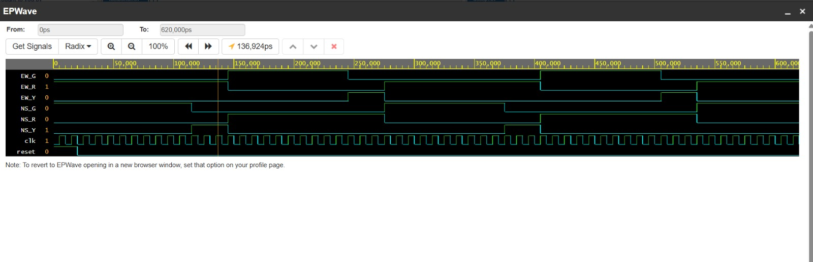

# Traffic-Light-Controller-Verilog
Moore FSM-based Traffic Light Controller designed using Verilog HDL with timer-controlled state transitions.
## Simulation Waveform

The simulation waveform below verifies the operation of the Moore FSM-based traffic light controller.

